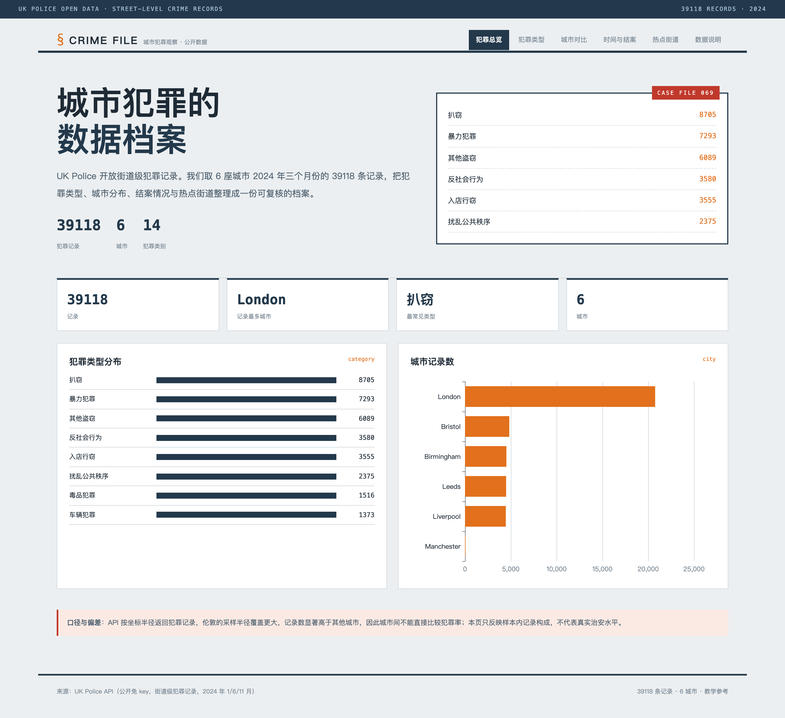
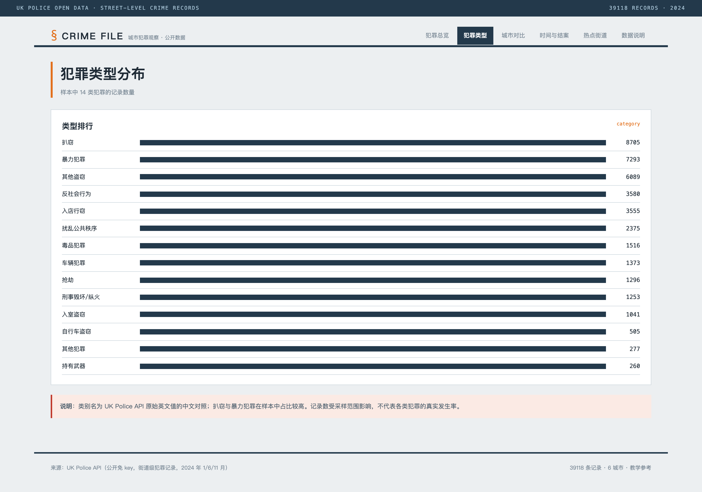
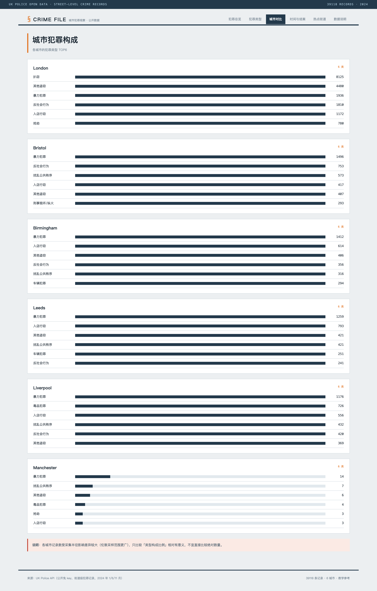
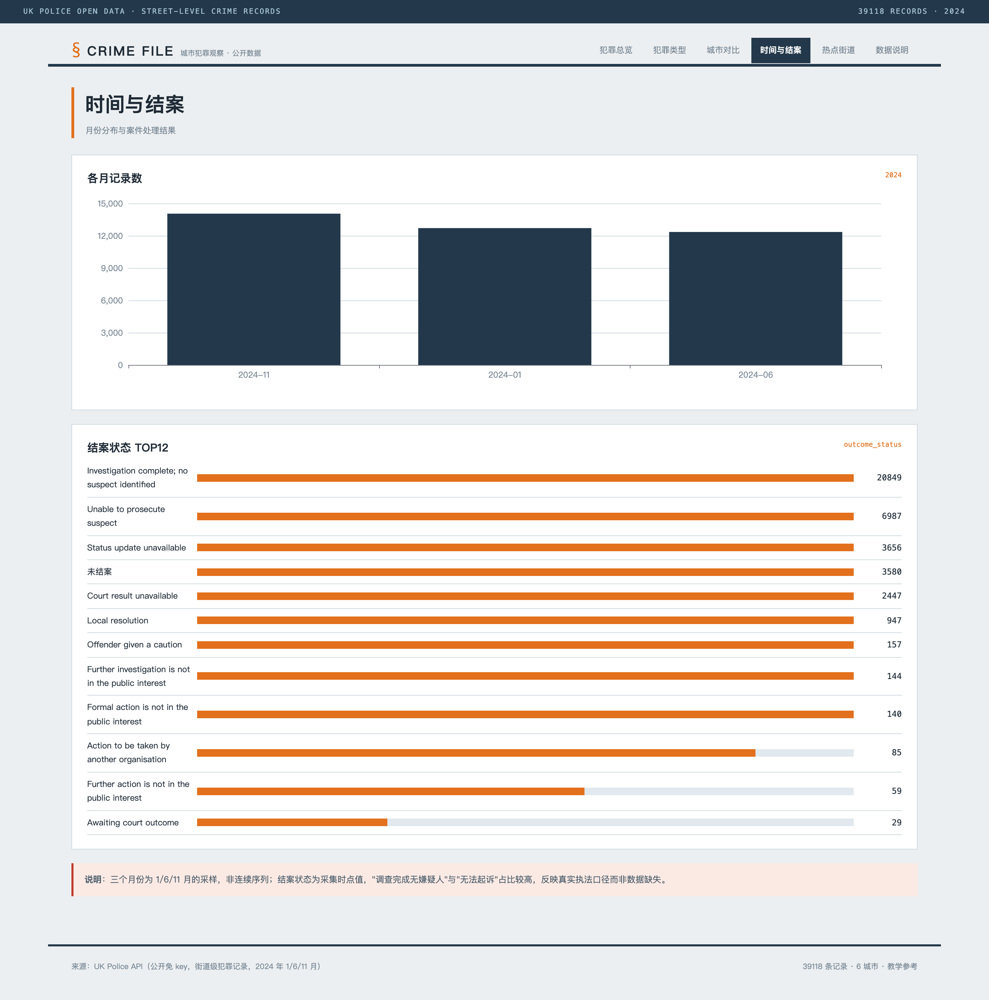
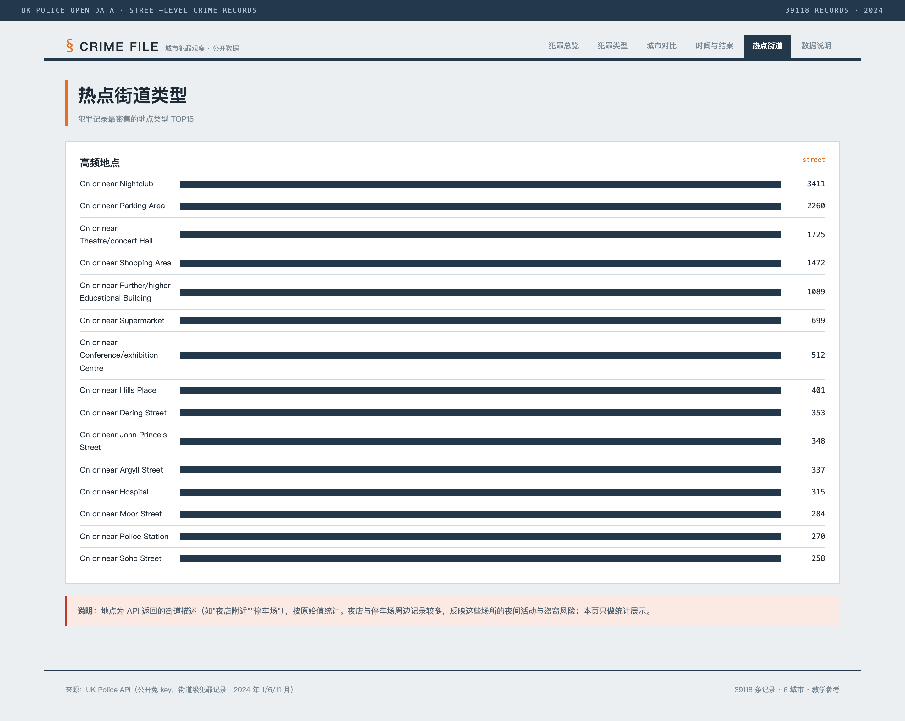
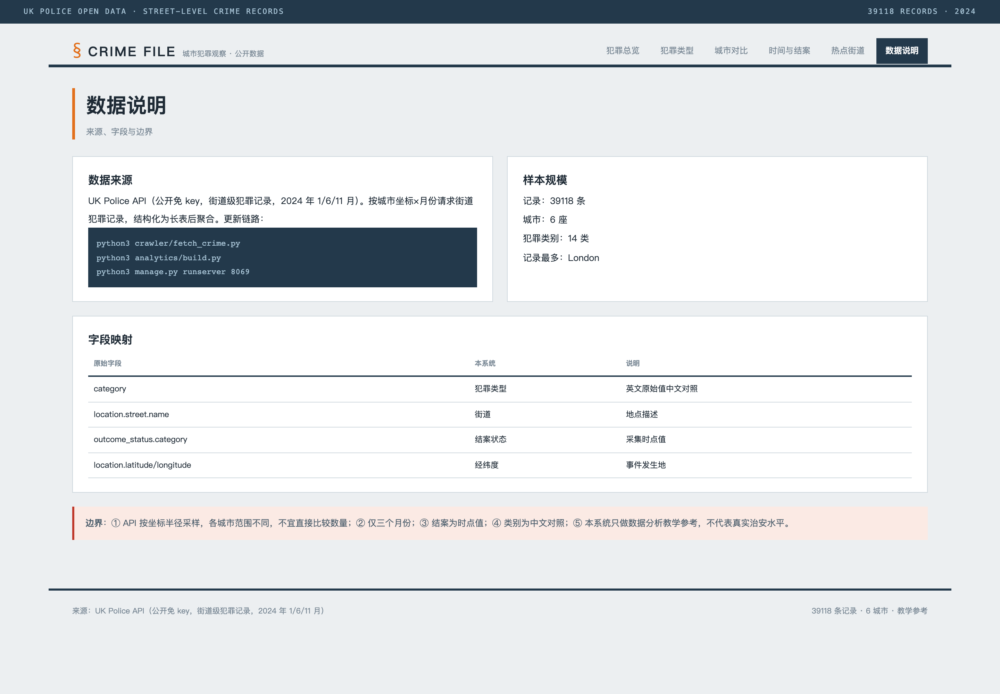

# 069 基于UK-Police公开数据的城市犯罪数据分析系统-设计展示

> **代码有偿获取 可接受定制 微信联系方式: csbysj2020 或 ACE2487，备注(BS)**

> **完整源码与全套文档 · 在线自助获取 >>> [https://mbd.pub/o/bread/YZaWmJptaQ==](https://mbd.pub/o/bread/YZaWmJptaQ==)**

> **成品页（功能介绍 / 更多选题）>>> [https://bishe.suilang.net/products/crime-file](https://bishe.suilang.net/products/crime-file)**

> 

> 

## 视频

> **点击查看 >>> [https://www.bilibili.com/video/BV1VaytzcEW2/](https://www.bilibili.com/video/BV1VaytzcEW2/)**

## 项目简介

警务档案风格（冷灰蓝、警示橙、档案卡片），区别于人口时钟/学术台账/街机/营养标签。采集 UK Police 公开街道犯罪 39118 条记录、6 城市、14 类犯罪，从类型、城市、结案与热点四维分析。Django + ECharts（本地化离线可用），6 个页面。坐标采样偏差与结案时点口径如实标注，不代表真实治安水平。

犯罪记录是观察城市治理的数据基础。

本项目设计并实现了一套基于 UK Police 公开数据的城市犯罪分析系统：通过 API 按城市坐标与月份获取 39118 条街道级犯罪记录，结构化后从犯罪类型、城市对比、月度趋势、结案状态与热点地点五个维度聚合分析。

系统采用 Django + ECharts 与警务档案式界面（冷灰蓝、警示橙、档案卡片），实现犯罪总览、犯罪类型、城市对比、时间与结案、热点街道、数据说明 6 个页面。

本仓库为**设计展示**：包含项目说明、技术架构、实验结果与运行截图；完整源码、任务书、开题报告、毕业论文与使用说明可通过上方链接自助获取，成品页可查看更多选题，也可联系微信咨询定制。

## 功能特性

1. 差异化视觉：警务档案（冷灰蓝/警示橙/档案卡片），非看板/画廊/时钟/台账

2. 真实采集：UK Police Crime API 公开免 key，39118 条街道级记录

3. 五维分析：犯罪类型/城市对比/月度趋势/结案状态/热点街道

4. 类型中文对照：14 类犯罪英文原始值对照

5. 城市对比：6 城市犯罪类型 TOP6 交叉，采样偏差透明

6. 热点街道：夜店与停车场周边记录较多

7. 技术栈差异化：Django + ECharts（本地化）

8. 合规边界：坐标半径采样有偏差，不代表真实治安水平

## 技术架构

| 项目 | 说明 |
| --- | --- |
| 编程语言 | Python 3.8+ |
| Web 框架 | Django 4.2 |
| 图表 | ECharts（本地化离线可用） |
| 数据源 | UK Police Crime API（公开免 key） |
| 样本规模 | 39118 记录 / 6 城市 / 14 类 |
| 运行端口 | http://127.0.0.1:8069 |
| 说明 | 数据直读 analysis JSON，无需数据库 |

## 目录结构

以下为完整交付版的结构（本仓库仅作设计展示）：

```
crime-file/
├── analytics/
│   └── build.py
├── crawler/
│   └── fetch_crime.py
├── crimeapp/
│   └── app.py
├── crimeproj/
│   ├── __init__.py
│   ├── settings.py
│   ├── urls.py
│   └── wsgi.py
├── data/
│   ├── analysis/
│   │   ├── categories.json
│   │   ├── cities.json
│   │   ├── cross.json
│   │   ├── months.json
│   │   ├── outcomes.json
│   │   └── streets.json
│   ├── processed/
│   │   └── crimes.csv
│   └── stats.json
├── static/
│   ├── css/
│   │   └── style.css
│   └── vendor/
│       └── echarts.min.js
├── templates/
│   ├── about.html
│   ├── base.html
│   ├── categories.html
│   ├── cities.html
│   ├── hotspots.html
│   ├── overview.html
│   └── trends.html
├── 任务书/
│   └── 毕业设计任务书.docx
├── 开题报告/
│   └── 毕业设计开题报告.docx
├── 最终论文/
│   ├── 图/
│   │   └── fig-arch.png
│   └── …
└── …
```

## 数据与实验结论

- 真实采集：UK Police Crime API 公开免 key，39118 条街道级记录
- 类型中文对照：14 类犯罪英文原始值对照
- 城市对比：6 城市犯罪类型 TOP6 交叉，采样偏差透明

## 交付内容

1. 完整源码（Django 应用 + 采集器 + 分析引擎 + 6 页面）
2. 真实数据（crimes.csv + analysis JSON）
3. 任务书与开题报告（Word）
4. 毕业论文（Word 七章制）
5. 二次开发说明（Word+md）
6. 6 张截图 + 封面 + 演示视频

## 常见问题

**城市间能直接比较吗？**

不能，API 按坐标半径采样，伦敦范围更大，页面已说明偏差。

**犯罪类型是原文吗？**

原始为英文，系统做了中文对照。

**结案状态是最终吗？**

是采集时点值，可能后续更新。

**图表能离线用吗？**

能，echarts.min.js 已本地化到 static/vendor/。

## 截图







